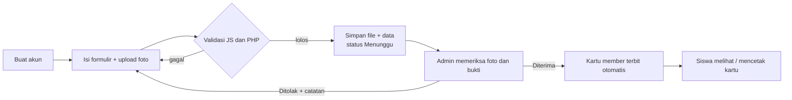

# PWEB: Back End Upload Foto pada Pendaftaran Siswa BIMBINGKU

---

## Membuat Pendaftaran Siswa Online dengan Upload Foto, Bukti Bayar, dan Kartu Member (PHP dan MySQL)

Untuk studi kasus manajemen kursus, saya membuat **BIMBINGKU**, aplikasi pendaftaran siswa bimbingan belajar berbasis PHP 8 dan MySQL. Selain menyimpan biodata, aplikasi ini menerima unggahan foto diri dan bukti pembayaran, membiarkan admin memeriksa keduanya, lalu menerbitkan kartu member berisi foto dan QR Code kepada siswa yang diterima.

Foto membuat admin lebih mudah mencocokkan data dengan orangnya, sedangkan bukti bayar menjadi dasar verifikasi. Setelah status berubah menjadi **Diterima**, kartu member terbit dengan sendirinya. Kartu bisa dicetak atau disimpan sebagai PDF lewat dialog cetak browser.

Source code: [GitHub](https://github.com/USERNAMEMU/NAMA-REPO)

---

## 1. Menyusun Alur Pendaftaran

Alur dimulai dari pembuatan akun. Siswa mengisi nama, email, dan password, lalu langsung diarahkan ke formulir pendaftaran. Di formulir, siswa melengkapi biodata, memilih cabang dan kelas, mengunggah foto, dan boleh menambahkan bukti pembayaran. JavaScript memeriksa isian dan file lebih dulu di browser. Meskipun begitu, PHP tetap memeriksa ulang semuanya di server karena pemeriksaan di browser mudah dilewati.

Sesudah data tersimpan, sistem membuat nomor registrasi dengan format `REG-TAHUN-NNNNN` dan menetapkan status awal **Menunggu**. Admin kemudian membuka halaman detail pendaftar, melihat foto dan bukti, lalu memutuskan **Diterima** atau **Ditolak**. Alasan penolakan wajib diisi. Siswa yang ditolak dapat memperbaiki data dan mengirimkannya lagi.



Selain alur utama, tersedia halaman **Cek Status** untuk umum. Pengunjung memasukkan nomor registrasi dan tanggal lahir, lalu melihat status dengan nama yang disamarkan.


## 2. Menyiapkan Struktur Database

Database bernama `bimbingku` berisi tujuh tabel: `users`, `branches`, `classes`, `students`, `member_cards`, `rate_limit_hits`, dan `audit_log`. Untuk fitur upload, tabel yang paling penting adalah `students`. Kolom `photo` dan `payment_proof` hanya menyimpan **nama file acak**, sedangkan berkasnya sendiri disimpan di disk.

```sql
CREATE TABLE students (
    student_id INT UNSIGNED NOT NULL AUTO_INCREMENT,
    user_id INT UNSIGNED NOT NULL UNIQUE,
    reg_number VARCHAR(30) NOT NULL UNIQUE,
    name VARCHAR(100) NOT NULL,
    birth_date DATE NOT NULL,
    address TEXT NOT NULL,
    phone VARCHAR(20) NOT NULL,
    email VARCHAR(100) NOT NULL,
    class_id INT UNSIGNED NOT NULL,
    branch_id INT UNSIGNED NOT NULL,
    photo VARCHAR(255) NOT NULL,
    payment_proof VARCHAR(255) NULL,
    registration_date DATETIME NOT NULL DEFAULT CURRENT_TIMESTAMP,
    status ENUM('Menunggu', 'Diterima', 'Ditolak') NOT NULL DEFAULT 'Menunggu',
    admin_note TEXT NULL,
    PRIMARY KEY (student_id)
    -- foreign key ke users, classes, dan branches ada di database.sql
) ENGINE=InnoDB;
```

Berbeda dengan menyimpan byte gambar di dalam tabel, saya memilih menyimpan file di folder agar basis data tetap ringan dan gambar bisa diganti tanpa menyentuh kolom besar. Konsekuensinya, penghapusan harus mengurus dua tempat sekaligus: baris di database dan file di disk. Hal ini ditangani di kode (lihat bagian 5).

Tabel pendukung lainnya:

| Tabel | Fungsi |
|-------|--------|
| `users` | Akun login dengan role `admin` atau `siswa`, password berupa hash bcrypt |
| `branches` | Data cabang (nama, alamat, telepon, email) |
| `classes` | Kelas per cabang, lengkap dengan jadwal, kuota, biaya, dan status aktif |
| `member_cards` | Kartu member: nomor kartu unik dan tanggal terbit, satu kartu per siswa |
| `rate_limit_hits` | Pencatatan percobaan login, registrasi, dan cek status |
| `audit_log` | Jejak aktivitas penting (login, perubahan status, penghapusan) |

Data awal berupa 3 cabang, 6 kelas, dan satu akun admin. Akun admin wajib mengganti password saat pertama kali masuk.

---

## 3. Menyiapkan Folder dan Formulir Upload

Berkas unggahan ditampung di dua folder: `uploads/foto/` untuk pas foto dan `uploads/bukti/` untuk bukti pembayaran. Di dalam setiap folder ada `.htaccess` yang menolak semua akses langsung dari URL. Jadi, orang tidak bisa menebak alamat gambar lalu membukanya. Berkas hanya keluar lewat `file.php`, yang lebih dulu memeriksa apakah pengguna sudah login dan berhak melihat file tersebut.

Formulir wajib memakai metode `POST` dan `enctype="multipart/form-data"`. Tanpa atribut itu, PHP tidak akan menerima file sama sekali.

```html
<form method="post" enctype="multipart/form-data" id="f" novalidate>
    <!-- token CSRF dan isian biodata -->
    <input type="file" name="photo" id="photo"
           accept="image/jpeg,image/png" required>
    <input type="file" name="payment_proof" id="proof"
           accept="image/jpeg,image/png,application/pdf">
    <button>Kirim Pendaftaran</button>
</form>
```

Atribut `accept` hanya mempermudah pemilihan file di dialog browser. Keputusan menerima atau menolak tetap ada di server. Saat siswa memilih foto, JavaScript memeriksa tipe dan ukurannya, lalu menampilkan pratinjau memakai `URL.createObjectURL()`. Pratinjau ini hanya ada di browser dan belum berarti foto sudah tersimpan.

Pilihan kelas juga disaring oleh JavaScript. Setelah cabang dipilih, hanya kelas milik cabang itu yang tampil. Server tetap mencocokkan pasangan cabang dan kelas ke database, jadi mengubah nilai lewat inspect element tidak berguna.

Satu hal kecil yang mudah terlewat adalah file yang melebihi `post_max_size`. Dalam kasus itu PHP mengosongkan `$_POST` dan `$_FILES`, sehingga token CSRF ikut hilang. Saya menambahkan pengecekan khusus di awal agar pengguna melihat pesan "ukuran terlalu besar", bukan pesan CSRF yang membingungkan.

---

## 4. Memvalidasi File Upload di Server

Semua pemeriksaan dikumpulkan dalam satu fungsi, `simpan_upload()`, yang dipakai untuk foto maupun bukti pembayaran. Urutannya:

| Langkah | Pemeriksaan |
|---------|-------------|
| 1 | Kode kesalahan upload harus `UPLOAD_ERR_OK` (ukuran berlebih dan kegagalan lain punya pesan sendiri) |
| 2 | Ukuran sebenarnya lebih dari 0 dan paling besar 2 MB |
| 3 | `is_uploaded_file()` memastikan file benar-benar berasal dari proses upload HTTP |
| 4 | Jenis file dibaca dari **isi** file dengan `finfo`. Foto: JPG atau PNG. Bukti: JPG, PNG, atau PDF |
| 5 | Khusus gambar, `getimagesize()` harus berhasil dan ukurannya antara 100x100 dan 8000x8000 piksel |

Ekstensi dan MIME yang dikirim browser sama sekali tidak dipercaya. File teks atau skrip yang hanya diganti namanya menjadi `.jpg` akan gagal di langkah 4.

```php
$mime = (new finfo(FILEINFO_MIME_TYPE))->file($f['tmp_name']);
if (!isset($izin[$mime])) {
    $err = "$label harus berformat " . strtoupper(implode('/', array_values($izin))) . '.';
    return null;
}
if (str_starts_with($mime, 'image/')) {
    $info = @getimagesize($f['tmp_name']);
    if ($info === false || $info[0] < 100 || $info[1] < 100
        || $info[0] > 8000 || $info[1] > 8000) {
        $err = "$label bukan gambar yang valid (minimal 100x100 piksel).";
        return null;
    }
}
```

Setelah lolos, file diberi nama acak dengan `bin2hex(random_bytes(16))`, dan ekstensinya diambil dari jenis file hasil deteksi, bukan dari nama asli. Dengan begitu tidak ada nama dari pengguna yang masuk ke path penyimpanan. Berkas lalu dipindahkan dengan `move_uploaded_file()`.

Validasi teks berjalan lebih dulu daripada pemrosesan file. Jadi, jika biodata saja sudah salah, tidak ada file yang sempat ditulis ke disk. Aturan lain di sisi server antara lain: nama maksimal 100 karakter, tanggal lahir harus masuk akal (umur 4 sampai 80 tahun), nomor HP 9 sampai 15 digit, dan kuota kelas harus masih tersedia.

Data tersimpan dalam satu transaksi database. Kalau penyimpanan gagal, file yang baru saja diunggah ikut dihapus supaya tidak ada berkas yatim di folder.

---

## 5. Menampilkan, Mengganti, dan Menghapus File

Gambar tidak pernah dipanggil langsung dari folder `uploads/`. Semua tampilan memakai `file.php?jenis=foto&id=...`. Endpoint ini:

- mewajibkan login,
- mengambil nama file dari database berdasarkan ID siswa,
- hanya melayani **admin** atau **pemilik data** (siswa lain mendapat 404),
- memeriksa bahwa nama file cocok dengan pola `^[a-f0-9]{32}\.(jpg|png|pdf)$`,
- mengirim `Content-Type` hasil deteksi `finfo`, header `X-Content-Type-Options: nosniff`, dan `Cache-Control: private`.

**Mengganti file.** Pada mode ubah data, input foto bersifat opsional. Jika dikosongkan, foto lama tetap dipakai. Jika diisi dengan file valid, nama file baru disimpan ke database, dan file lama baru dihapus setelah transaksi berhasil. Bila file pengganti ditolak, data dan foto lama tidak berubah. Siswa yang berstatus **Diterima** tidak bisa mengubah datanya lagi.

**Menghapus.** Admin dapat menghapus pendaftar dari halaman detail setelah konfirmasi. Baris di `students` dihapus, kartu member ikut terhapus lewat `ON DELETE CASCADE`, lalu foto dan bukti pembayaran dihapus dari disk.

Seluruh aksi yang mengubah data memakai `POST` dan token CSRF. Token dicek otomatis untuk setiap request POST di `lib/bootstrap.php`, jadi tidak ada form yang terlewat. Data pengguna yang ditampilkan di HTML selalu melalui `htmlspecialchars()`, dan semua query memakai prepared statement.

---

## 6. Membuat Kartu Member

Pada rancangan ini, hasil akhir dari alur upload adalah kartu member. Kartu terbit saat admin mengubah status menjadi **Diterima**. Pada saat itu sistem mencatat satu baris di `member_cards` dengan nomor `BMB-TAHUN-NNNNN` dan tanggal terbit hari itu. Jika status kemudian diubah kembali menjadi Menunggu atau Ditolak, kartunya dicabut.

Sebelum menerima, admin juga dicegah melampaui **kuota kelas**. Jumlah siswa berstatus Diterima dihitung ulang di server setiap kali status akan diubah.

Halaman `kartu.php` menampilkan nama, nomor kartu, ID siswa, kelas, cabang, tanggal bergabung, pas foto, dan QR Code. QR dibuat di browser dari nomor kartu menggunakan pustaka `qrcodejs` dari cdnjs, sehingga tidak ada data siswa yang dikirim ke layanan pembuat QR pihak lain.

```js
new QRCode(document.getElementById('qr'), {
    text: <?= json_encode($kartu['card_number']) ?>,
    width: 92, height: 92
});
```

Tombol **Cetak / Simpan PDF** memanggil `window.print()`. Aturan CSS `@media print` menyembunyikan navbar, footer, dan tombol, sehingga yang tercetak hanya kartu. Pengguna bisa memilih printer atau opsi *Save as PDF*. Siswa melihat kartunya sendiri, sedangkan admin dapat membukanya dari halaman detail pendaftar.

---

## 7. Menjalankan di Lokal dan Catatan Deployment

Kebutuhan: PHP 8.0 atau lebih baru (kode memakai `str_starts_with`), MySQL/MariaDB, dan ekstensi `mysqli`, `fileinfo`, serta `mbstring`. Pada XAMPP dan Laragon, ketiganya biasanya sudah aktif.

1. Salin folder `bimbingku` ke `htdocs` (XAMPP) atau `www` (Laragon).
2. Aktifkan Apache dan MySQL.
3. Impor `database.sql` melalui phpMyAdmin (tab Import).
4. Periksa konstanta koneksi di `lib/bootstrap.php`. Bawaan XAMPP: user `root`, password kosong, database `bimbingku`.
5. Pastikan `uploads/foto` dan `uploads/bukti` dapat ditulis oleh web server.
6. Buka `http://localhost/bimbingku/`.

Akun awal: admin `admin@bimbingku.test` dengan password `password` (wajib diganti pada login pertama). Siswa mendaftar sendiri lewat tombol **Daftar**.

Catatan penting untuk server sungguhan:

- Nilai `upload_max_filesize` dan `post_max_size` di `php.ini` harus setidaknya 2 MB, lebih aman sedikit di atasnya karena satu form membawa dua file.
- Jika memakai **Nginx**, `.htaccess` tidak berlaku. Tambahkan aturan `location /uploads { deny all; }`.
- Folder `uploads/` jangan dimasukkan ke repository. File `.gitignore` di proyek sudah mengaturnya, sedangkan `.gitkeep` dan `.htaccess` tetap ikut.
- Aplikasi ini belum dipasang di hosting publik. Aplikasi ini baru berjalan secara lokal.

**Struktur folder utama**

| File / Folder | Fungsi |
|---------------|--------|
| `lib/bootstrap.php` | Koneksi DB, session, CSRF otomatis, helper, kerangka halaman, fungsi upload |
| `siswa/form.php` | Formulir pendaftaran (tambah dan ubah) dengan upload foto dan bukti |
| `siswa/index.php` | Dashboard siswa |
| `file.php` | Penyaji foto dan bukti dengan pengecekan hak akses |
| `kartu.php` | Kartu member, QR Code, dan cetak |
| `admin/index.php`, `admin/siswa.php`, `admin/siswa-detail.php`, `admin/kelas.php` | Dashboard, daftar pendaftar, verifikasi, dan pengelolaan kelas |
| `login.php`, `register.php`, `logout.php`, `ganti-password.php` | Autentikasi |
| `index.php`, `profil.php`, `kelas.php`, `cek-status.php` | Halaman publik |
| `uploads/` | Penyimpanan foto dan bukti (ditutup `.htaccess`) |

---

## 8. Pengujian dan Hasil Pembelajaran

> **Catatan jujur:** kode ini belum saya jalankan secara menyeluruh di server PHP. Tabel di bawah adalah skenario pengujian beserta hasil yang diharapkan. Kolom hasil diisi setelah pengujian di XAMPP/Laragon.

| No | Skenario | Hasil yang diharapkan | Hasil |
|----|----------|-----------------------|-------|
| 1 | Unggah foto PNG/JPG valid (di bawah 2 MB) | Data tersimpan, foto tampil di dashboard | [ ] |
| 2 | Unggah file lebih dari 2 MB | Ditolak dengan pesan ukuran | [ ] |
| 3 | Ganti nama file `.txt` atau `.php` menjadi `.jpg` lalu unggah | Ditolak karena isi bukan gambar | [ ] |
| 4 | Unggah GIF atau SVG sebagai foto | Ditolak | [ ] |
| 5 | Unggah gambar di bawah 100x100 piksel | Ditolak | [ ] |
| 6 | Kirim form tanpa foto saat daftar pertama kali | Ditolak, pesan "Foto wajib diunggah" | [ ] |
| 7 | Ubah data tanpa memilih foto baru | Foto lama tetap | [ ] |
| 8 | Ubah data dengan foto baru valid | Foto berganti, file lama terhapus dari `uploads/foto` | [ ] |
| 9 | Ubah data dengan foto baru tidak valid | Ditolak, data dan foto lama tidak berubah | [ ] |
| 10 | Buka `/uploads/foto/namafile.jpg` langsung di browser | Akses ditolak (403) | [ ] |
| 11 | Siswa A membuka `file.php?id=` milik siswa B | 404 | [ ] |
| 12 | Kirim POST tanpa token CSRF | Ditolak (400) | [ ] |
| 13 | Admin menerima pendaftar | Status Diterima, kartu member terbit | [ ] |
| 14 | Admin menolak tanpa mengisi catatan | Ditolak dengan pesan catatan wajib | [ ] |
| 15 | Admin menerima pendaftar di kelas yang kuotanya penuh | Ditolak dengan pesan kuota | [ ] |
| 16 | Admin mengembalikan status ke Menunggu | Kartu member dicabut | [ ] |
| 17 | Admin menghapus pendaftar | Baris DB dan file foto/bukti hilang | [ ] |
| 18 | Siswa mengakses halaman `admin/` | 403 | [ ] |
| 19 | Cetak kartu dari browser | Hanya kartu yang tercetak, tanpa navbar | [ ] |
| 20 | Cek status dengan nomor registrasi dan tanggal lahir benar/salah | Status tampil dengan nama disamarkan / pesan tidak ditemukan | [ ] |

**Hasil pembelajaran.** Dari proyek ini saya menyadari bahwa upload file bukan sekadar `move_uploaded_file()`. Prosesnya mencakup beberapa tahap: menerima form multipart, memeriksa file dari isinya, menyimpan dengan nama yang aman, mengatur siapa yang boleh melihat, menampilkannya lewat jalur yang terkontrol, dan membersihkan berkas ketika data diganti atau dihapus. Kartu member melengkapi alur itu, karena foto yang diunggah akhirnya dipakai sebagai identitas siswa.

**Keterbatasan.** Peran pengajar, admin cabang, dan keuangan; presensi; nilai; materi; pengumuman; serta laporan PDF/Excel dari spesifikasi lengkap belum dikerjakan karena fokus tugas ini adalah upload foto. Beberapa kolom di tabel `member_cards` pada spesifikasi (`qr_code` dan `pdf_card`) tidak dipakai, sebab QR dibuat langsung di browser dan PDF dibuat lewat fitur cetak.

---

## Dokumentasi Teknis

- PHP Manual: Handling file uploads
- PHP Manual: `move_uploaded_file`
- PHP Manual: Fileinfo (`finfo`)
- PHP Manual: `getimagesize`
- MySQL Reference Manual: `FOREIGN KEY` dan `ON DELETE CASCADE`
- qrcodejs: pustaka pembuat QR Code di browser (cdnjs)

